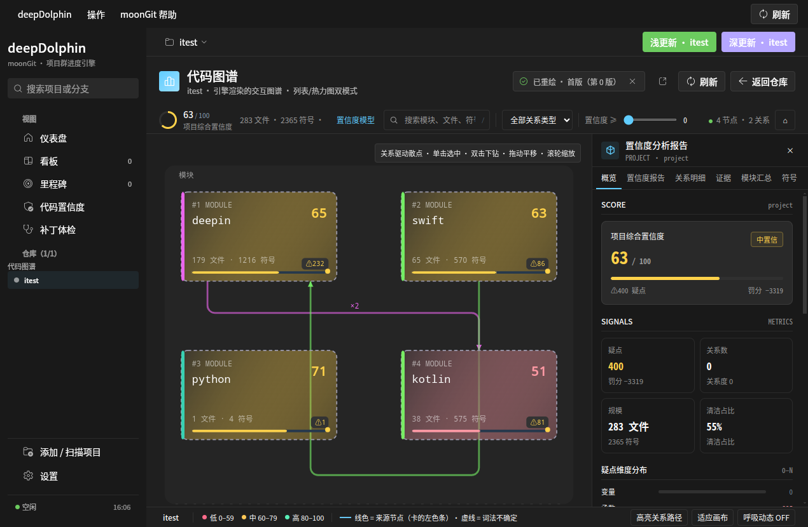
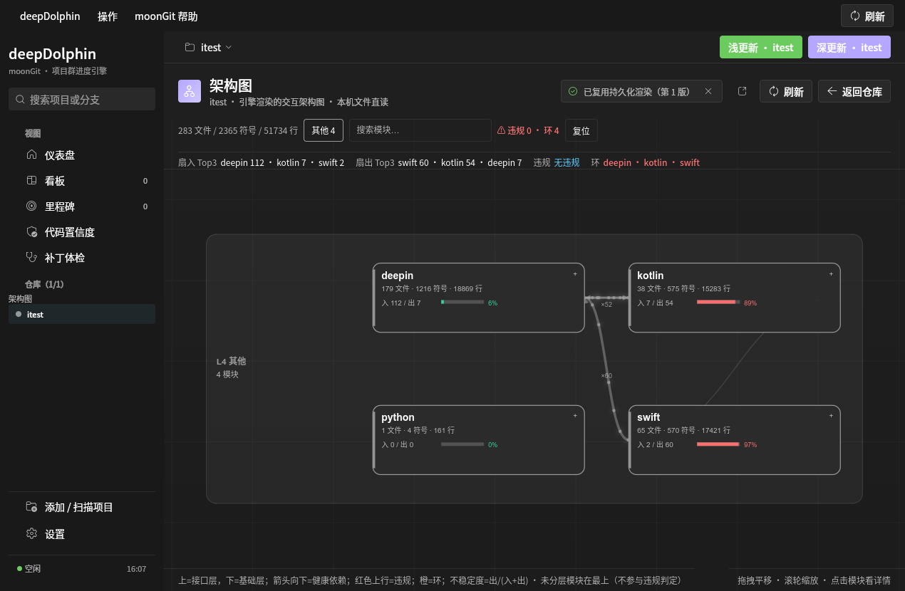
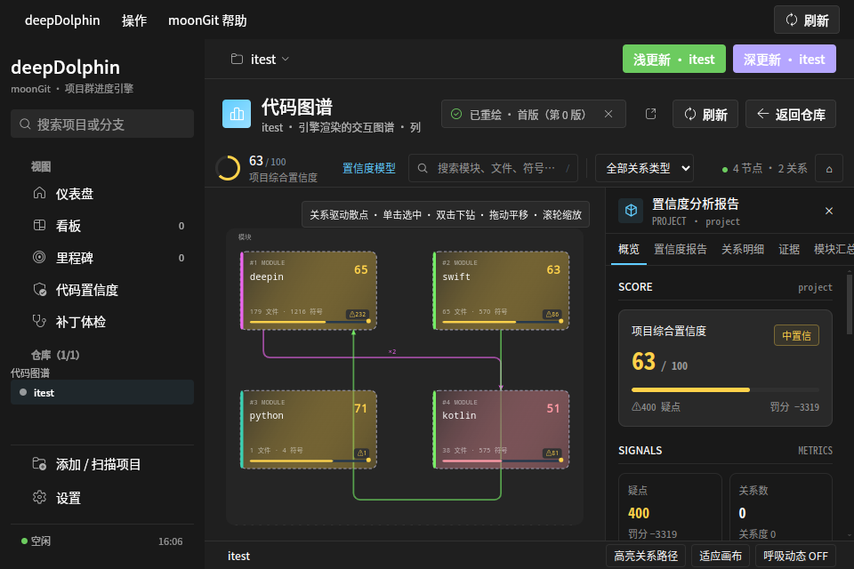
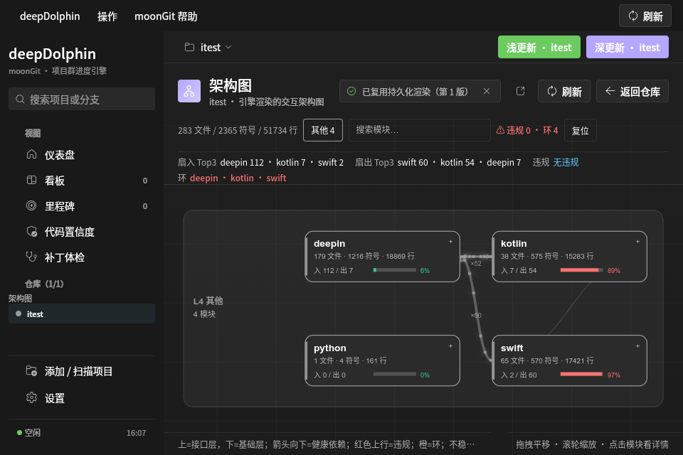

# CMP 客户端真窗口实拍（2026-11-25）

全部取自**打包后的 deb 提取运行**（`gradle packageDeb` → `dpkg-deb -x` → `opt/deepdolphin/bin/deepdolphin`，
`DISPLAY=:0`，窗口 1270×830，打包态 `STARTUP_MS=864`）。截图前逐项确认焦点在本应用窗口，
截到别的窗口的图一律不入库。本目录之前的 48 张旧图已退役——其中至少 9 张截到的是 IDE，
还有一张标着「图谱页验证通过」的其实是空白页。

引擎为本机 `~/.local/bin/moongit`（0.2.0），项目是两个测试仓库 vtest / vtest2。
`04` / `09` / `10` / `13` / `14` 五张在 2026-11-26 重拍：引擎是 0.3.0 的开发构建（带图谱产物的嵌入模式），
客户端是图谱两页按页面完整适配之后的包。`04` / `09` / `13` 用本机已安装的引擎与真实注册表（vtest），
`10` / `14` 用 `MOONGIT_BIN` 指向沙箱引擎（多模块的探针工程 itest）。

| 文件 | 内容 |
|---|---|
| `01-dashboard.png` | 仪表盘：Fluent 命令条（范围选择器 + 双轨按钮）、时间窗筛选、KPI、项目卡 |
| `02-board.png` | 看板：分区只留标题，项目行是唯一卡片层；右缘滚动条 |
| `03-milestones.png` | 里程碑：仓库下拉与搜索框同一套描边控件 |
| `11-milestone-repo-dropdown.png` | 仓库下拉展开：真正的浮出菜单，选中项带勾 |
| `04-confidence.png` | 代码置信度：六维度 + 疑点清单（真图标状态标记）；疑点行右侧是「证据名 @ 挂靠符号的限定名」（`suspect.py:36 · risky @ swallow`） |
| `05-patchcheck.png` | 补丁体检 |
| `06-detail.png` | 项目详情：页头动作 + 两个带图标的图谱入口按钮 |
| `09-code-graph.png` | **代码图谱（热力图）**：跟仓库走的独立页面。引擎产物按嵌入模式收拢外壳——页头下面一条命令条（综合置信度、搜索、筛选），画布占页面主体，底部一条面包屑条；配色、圆角、描边走客户端的设计令牌 |
| `15-appearance-themes.png` | **设置 · 外观**：14 套皮肤（namethatui.com/styles 全风格 − flat）的切换卡，三色预览点即点即换 |
| `13-heat-map-locator.png` | **热力图定位区**：双击模块 → 双击文件下钻到符号层，选中 `swallow` 节点——右侧「定位」给出定位串 `suspect.py:34:5`、限定名、符号 ID、签名，各带复制（不用滚动就看全） |
| `14-heat-map-modules.png` | **多模块工程的热力图**（9 种语言、283 文件、2365 符号）：四个模块卡片按置信度着色，连线颜色 = 来源节点，带权重 |
| `10-arch.png` | **架构图**：贴顶的命令条（计数、分层筛选、搜索、复位）加一行架构体检摘要；画布上的模块卡片是中性底色；选中模块后右侧详情面板带模块路径与「复制模块路径」 |
| `07-settings-general.png` | 设置 · 通用：Fluent Pivot 页签（下划线指示）、语言选择（accent 底配近黑字） |
| `08-settings-ai.png` | 设置 · AI 配置 |
| `12-menu-operations.png` | 窗口内菜单条「操作」下拉：跟随当前范围、描边 + 投影 |

没拍到但实测过的：侧栏 Fluent 图标、启动后不点击直接按 Ctrl+2/3（AWT 层接管快捷键）、
图谱页里 WebView 持有焦点时 Ctrl+1 / Ctrl+F、连续 12 次改窗口尺寸后图谱仍可交互、
SIGTERM 正常退出与「关闭钩子卡死时 4 秒硬退」兜底。

图谱两页按页面完整适配（用户反馈「现在是直接嵌套的，有些不美观」）：

- 原样内嵌时画布上下叠了六条横杠，1270×830 的窗口里画布约 330px 高；适配后画布约 557px（占窗口高度 67%）。
- 窄窗口（1000×700）与宽窗口（1680×980）都实拍过：窄时仍然左右分栏、置信度滑块让位，画布随容器重新取景。
- 独立打开产物（页头的「在浏览器中打开」）仍是完整版：引擎产物不收到嵌入声明时与原先一样。

引擎协同补丁的真机联调（同一台机器、同一个包）：

- **快照过期自愈**：改了测试仓库的源码后点图谱页「刷新」，引擎调用序列是
  `render index --confidence` → `confidence gen` → `render index --confidence --force`，页面上的热力图是新一版的（跑了两次）。
- **升级后的旧索引自动重建**：旧构建留下的索引（函数节点没有列号 / 签名）点一次刷新就被引擎重建、客户端补生成快照并重绘。
- **复制**：定位串 `suspect.py:34:5`、符号 ID `f:suspect.py:34:swallow`、模块路径 `(root)` 三次点击后都从 X11 剪贴板原样读回
  （`file://` 页面没有剪贴板权限，走的是隐藏 textarea 兜底）。

嵌入尺寸融合（2026-11-26，打包态真窗口按应用窗口取图；itest = 四个模块的多语言样例）：

*16 · 代码图谱 1270×830：四张卡 2×2、1.3 倍；色带包住卡片；回执进了页头（「已重绘」胶囊）；
底部一条通栏——面包屑 · 图例 ·· 操作按钮。对比 `09-code-graph.png`：原先卡片 0.69 倍、元信息 6px，
底部叠着图例、面包屑、回执三条。*

*17 · 架构图 1270×830：四个模块折成 2×2、1.35 倍（原先挤在一条泳道里 0.77 倍）；图例成了底部的通栏条。*

*18 · 代码图谱 960×640（窗口最小尺寸）：按区域重排后仍在色带内，图例按断点收起，副标题自动截断。*

*19 · 架构图 960×640：泳道缩进画布、图例截断成省略号——改动前的实拍里，同样的缩窄会让卡片被窗口右缘裁掉半张。*
